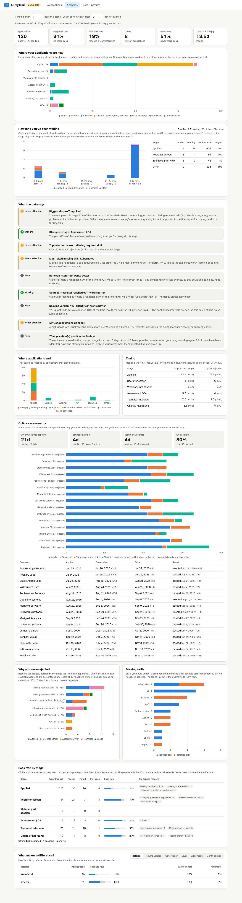
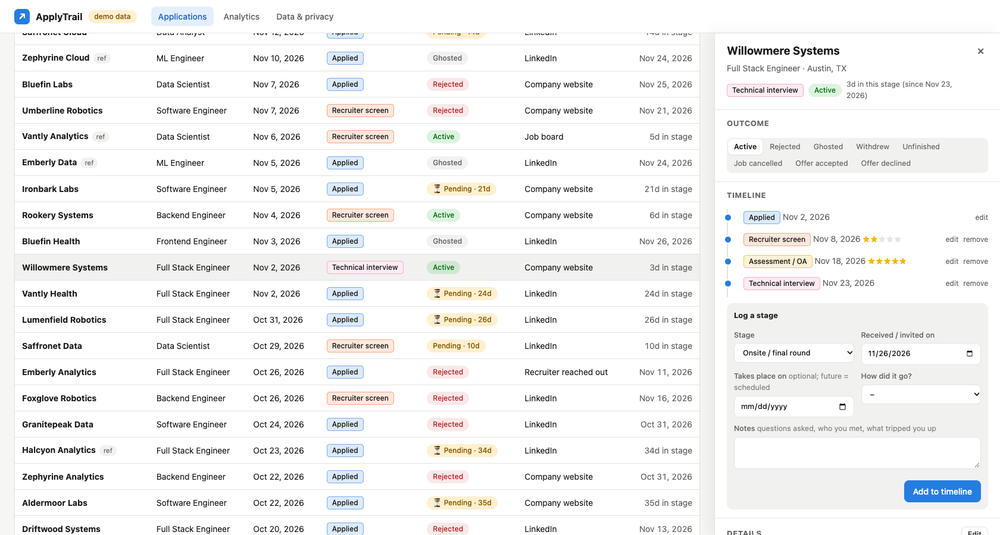

# ApplyTrail

**A local-first job application tracker that tells you *where* your search is failing, and why.**

Most trackers are spreadsheets with a status column. ApplyTrail logs every stage each
application reaches (screen, assessment, technical, onsite, offer), along with how you think
each interview went and why you were rejected. It then shows where in the funnel you get
filtered out and what changes your odds.

Your data never leaves your machine: it lives in a SQLite file that git ignores, the server
listens only on `127.0.0.1`, and the app makes no outside requests.



<details>
<summary>Applications view</summary>



</details>

> Screenshots use generated demo data (`make demo`). The companies are made up.

## Logging is fast

* **Quick add**: paste `link, job title, company, date` into the bar at the top, one
  application per line. A live preview shows how each line was read before anything is saved.
  The link and date are optional, many date formats work (`2026-11-26`, `11/26`,
  `Nov 26, 2026`, `today`, `3 days ago`), job titles may contain commas, `Acme, Inc.` stays one
  company, the source is guessed from the link (LinkedIn, job board, company site), and
  duplicates are flagged.
* **Rejections**: pick every reason that applies (missing preferred skill, missing required
  skill, OA fail, interview performance, job closed when rejected, has open question in
  application). Type a new one under **Other** and it joins the list for next time. The two
  missing-skill reasons ask *which* skills, comma-separated, and suggest skills you've
  entered before so names stay consistent.
* **Outcomes**: besides rejected, ghosted and offers, an application can be **Unfinished** (you
  didn't complete an OA or recorded interview) or **Job cancelled** (the employer pulled the
  role). Neither counts against your pass rates; both are shown separately.
* **Two dates per stage**: when you received it (the OA, the interview invite) and when you
  took it or it takes place. A future date marks the step as **scheduled**.
* **Dates everywhere**: every stage carries a date (today unless you change it), and every
  outcome (rejected, ghosted, withdrew, offer decision) gets an outcome date, set automatically
  when you change the outcome.
* **Active vs pending**: an open application is **active** while its current stage has moved
  in the last 7 days, and **pending** after that, so you know who to follow up with. The
  threshold is adjustable.

## What it answers

| Question | How |
|---|---|
| **Where is everything right now?** | A pipeline chart puts each application at the furthest stage it reached, colored by status: active, pending, rejected, ghosted, withdrew, accepted. |
| **What am I waiting on, and for how long?** | A bar graph groups open applications by days without movement (0–6, 7–13… days, plus scheduled steps), colored by stage, with median and longest wait per stage. |
| **Where do I drop out?** | Pass rate at each stage, counting only applications that actually went *through* that stage, with 95% Wilson confidence intervals so a 1-of-2 result doesn't look like a trend. |
| **Why?** | Rejection reasons (multi-select, including your own) counted and split by the stage the rejection came at, plus your written reflections. |
| **What should I learn next?** | Missing skills ranked across all rejections, split into required vs preferred. |
| **What helps?** | Response, interview and offer rates split by source, referral, resume version, cover letter, level, work mode and month. Small groups are flagged. |
| **How do my online assessments go?** | For each OA: days from applying until it arrived, days until you took it, days until the result, plus the OA pass rate. |
| **Am I being ghosted?** | Applications with no activity for *N* days count as "likely ghosted" instead of quietly inflating your rates. *N* is configurable. |
| **So what should I do?** | Rule-based insights: the bottleneck stage with targeted advice, levers that make a real difference (with a note when the gap could still be noise), follow-up reminders, and data-quality warnings. |

## Quick start

Requirements: Python 3.11+ and Node 18+.

```bash
git clone https://github.com/<you>/applytrail.git && cd applytrail
make setup        # Python venv + npm install + privacy pre-commit hook
make run          # build the UI and serve everything at http://127.0.0.1:8000
```

Other commands:

```bash
make demo         # try it with 120 fictional applications (uses data/demo.db, not your real DB)
make dev          # hot-reload: API on :8000, UI on http://127.0.0.1:5173
make test         # pytest + TypeScript type-check
```

<details>
<summary>Without make (e.g. Windows)</summary>

```bash
cd backend && python -m venv .venv && .venv/bin/pip install -r requirements-dev.txt   # Windows: .venv\Scripts\pip
cd ../frontend && npm install && npm run build
cd ../backend && .venv/bin/uvicorn app.main:app --host 127.0.0.1 --port 8000
git config core.hooksPath .githooks
```
</details>

## Privacy model

This repository is meant to be public while your job search stays private.

| Layer | Protection |
|---|---|
| Storage | Everything is in `data/applytrail.db`. `data/` is git-ignored except `.gitkeep`. Set `APPLYTRAIL_DB=/path/to/file.db` to keep the file elsewhere, e.g. an encrypted volume. |
| Git | `.gitignore` covers `*.db`, `*.sqlite`, `.env`, and the app's export and backup files. `.githooks/pre-commit` also **refuses commits** that stage any of them, even with `git add -f`. `make setup` enables the hook. |
| Network | The server binds to `127.0.0.1`. No telemetry, no CDN fonts, no third-party calls. |
| Demo data | `make seed` writes fictional data to `data/demo.db` and refuses to overwrite `applytrail.db`. |
| Backups | **Data & privacy → Export** downloads a JSON backup or a CSV. Both contain personal data, so keep them out of the repo; the hook blocks the default filenames. |

## Data model

```
Application ── company, role, applied_date, source, referral, resume_version, cover_letter,
   │           level, work_mode, location, salary range, tags, notes,
   │           outcome (active | rejected | ghosted | withdrawn | accepted | declined), outcome_date,
   │           rejection_reasons[], missing_required_skills[], missing_preferred_skills[],
   │           reflection
   └── StageEvent* ── stage (applied → screen → assessment → technical → onsite → offer),
                      date, self_rating 1–5, notes

ReasonOption ── custom rejection reasons you added (built-in ones live in code)
```

An `applied` event is created automatically. Stages can be skipped (not every company gives
an online assessment) or repeated (several technical rounds). The analytics take both into
account.

### Metric definitions

* **Eligible**: an application old enough to judge. It progressed, was rejected or ghosted,
  or has been silent for `ghost_days`. Fresh applications still waiting for a reply are left
  out of the rates.
* **Stage pass rate** = passed / (passed + failed), counting only applications with an event
  at that stage. *Failed* means rejected, ghosted, or silent for `ghost_days`. Withdrawn and
  pending applications are excluded.
* **Response / interview / offer rate**: the share of eligible applications that reached the
  screen, technical, or offer stage.
* **Days in stage** = today minus the last movement at the application's current stage: the date
  you took the step (e.g. the OA) if recorded, otherwise the date you received it. A new round in
  the same stage resets the clock, and a step scheduled in the future keeps the application active. **Pending** means `days in stage >= pending_days`
  (default 7, set it in Analytics or with `APPLYTRAIL_PENDING_DAYS`).
* **Days to rejection** uses the outcome date: per stage, it's measured from the last movement in
  that stage. Overall, it's measured from the application date.
* **Rejection reasons** are multi-select, so a reason's share is "% of rejections citing it",
  and the shares can add up to more than 100%. Skill names are matched case-insensitively.

All of this lives in [`backend/app/analytics.py`](backend/app/analytics.py) as pure functions
over plain dataclasses, with unit tests in `backend/tests/`.

## Importing from a spreadsheet

**Data & privacy → Import** accepts a CSV with at least `company`, `role` and `applied_date`
(YYYY-MM-DD). Every column from the CSV export is understood, e.g. `source`, `outcome`,
`rejection_reasons`, `missing_required_skills`, `current_stage`, `screen_date`, `technical_date`.
Enum columns accept either the value (`linkedin`) or the label (`LinkedIn`). Separate multiple
rejection reasons with `;`; reasons that don't exist yet are added as custom reasons. Skills can
be separated with `,` or `;`. Imports are all-or-nothing: one bad row and
nothing is written, and the error says which row.

## Importing an existing tracker workbook

If you've been tracking applications in an Excel workbook with an **Applied** sheet
(`date_applied, category, company, role, location, apply_url, resume_pdf_used,
application_status, follow_up_date, notes`):

```bash
make import XLSX=~/path/to/tracker.xlsx DRY=1   # preview what would be imported
make import XLSX=~/path/to/tracker.xlsx         # import (backs up an existing database first)
```

Statuses like `Rejected - user reported 2026-11-12`, `OA - …`, `Interview - …` and
`Job cancelled - …` become outcomes and dates. Dated `Outcome YYYY-MM-DD: …` entries in the
notes become stage events. Re-running skips rows that are already imported. Workbooks
(`*.xlsx`) are git-ignored and blocked by the pre-commit hook.

## Stack

* **Backend**: FastAPI, SQLModel (SQLAlchemy and Pydantic), SQLite, pytest, ruff
* **Frontend**: React 18, TypeScript, Vite, Recharts. No UI framework, light and dark themes.
* **CI**: GitHub Actions runs lint, tests and the production build on every push.

```
applytrail/
├── backend/app/
│   ├── analytics.py      # all metrics + insights (pure, unit-tested)
│   ├── models.py         # SQLModel tables + API schemas
│   ├── routers/          # applications, analytics, import/export
│   └── seed.py           # fictional demo-data generator
├── frontend/src/
│   ├── pages/            # Applications, Analytics, Data & privacy
│   └── components/       # drawer, forms, charts
├── data/                 # your database (git-ignored)
└── .githooks/pre-commit  # blocks personal data from being committed
```

## API

Interactive docs are at `http://127.0.0.1:8000/docs` while the server runs. Main endpoints:
`GET/POST /api/applications`, `PATCH/DELETE /api/applications/{id}`,
`POST /api/applications/quick` (`{"text": "...", "dry_run": true}` previews the parse),
`POST /api/applications/{id}/events`, `GET/POST/DELETE /api/reasons`, `GET /api/skills`,
`GET /api/analytics?ghost_days=21&pending_days=7`,
`GET /api/export/{json|csv}`, `POST /api/import/{json|csv}?mode=append|replace`.

## Roadmap ideas

- [ ] Follow-up reminders and a "this week" view
- [ ] Interview question log, tagged by topic, to find weak topics across companies
- [ ] Optional encryption at rest (SQLCipher)
- [ ] Parse job postings to compare required skills against rejections

## License

MIT
